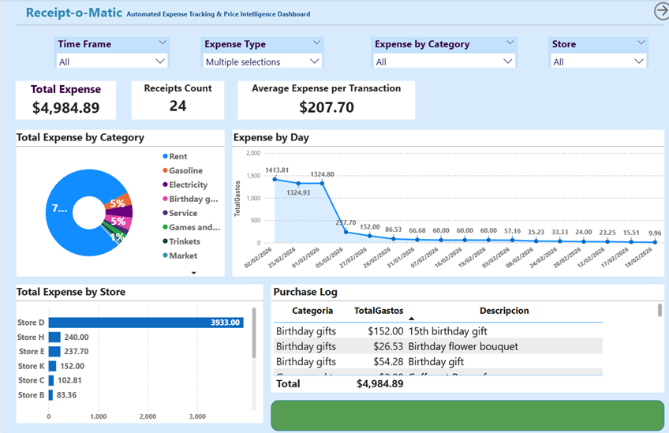
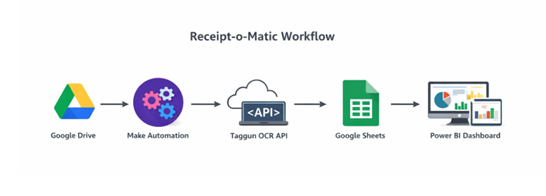
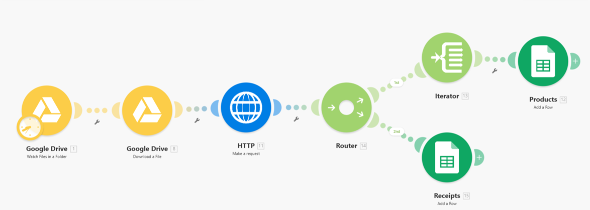
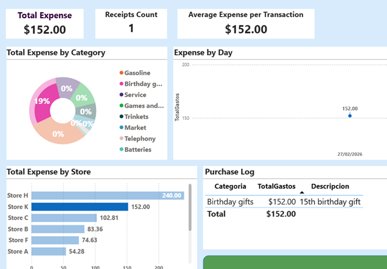
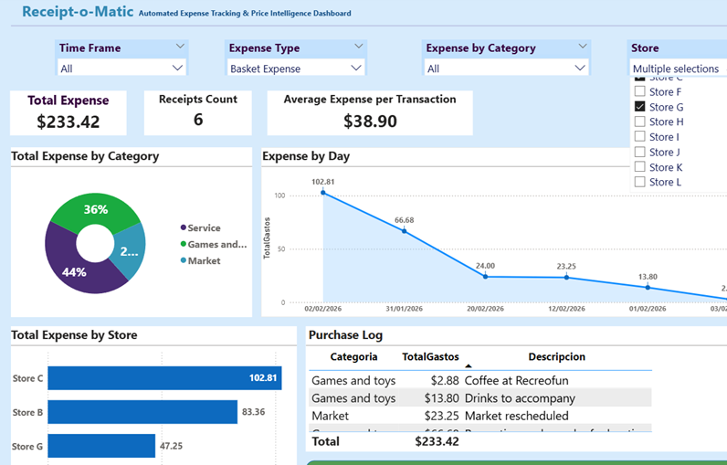

# Receipt-o-Matic

**Automated expense tracking and store price comparison: receipt photo → OCR → Google Sheets → Power BI.**

Receipt-o-Matic is an end-to-end personal data pipeline. When a photo of a grocery receipt is dropped into a Google Drive folder, a **Make** scenario sends it to the **Taggun receipt-OCR API**. The scenario cleans the response and writes it to Google Sheets as a receipt table and a line-item table. A **Power BI** model then combines those receipts with manually logged expenses (rent, utilities, gas…), sorts every product into a category with a keyword-priority rule, and reports monthly spending and price differences between stores.



---

## What it answers
- How much do we spend per month, and how much of that is fixed costs vs. the grocery basket?
- Which categories drive the grocery basket?
- Which store is cheaper for the same kind of product?
- What did each purchase contain, line by line?

## Architecture



| Step | Tool | What happens |
|---|---|---|
| 1. Ingest | Google Drive | A receipt image is uploaded to a watched folder |
| 2. Trigger | Make: *Watch files in a folder* → *Download a file* | The new file is picked up automatically |
| 3. OCR | Make: HTTP POST to `api.taggun.io/api/receipt/v1/verbose/file` | Taggun returns merchant, date, totals, tax, discount and product line items |
| 4. Transform | Make: Router + Iterator | Receipt header and line items are split. Item names are cleaned (regex strips trailing 8+ digit product codes), numbers are parsed with defaults for empty values, and dates are converted to `YYYY-MM-DD` |
| 5. Store | Google Sheets: *Add a row* | Rows go to the **Recibos** (receipts) and **Productos** (line items) sheets |
| 6. Manual expenses | Google Forms → Sheets | Non-receipt expenses (rent, electricity, gas, gifts…) are logged through a form |
| 7. Model & report | Power BI (Power Query + DAX) | Tables are loaded, unified, categorised and visualised |



## Data model

The source sheets and columns are in **Spanish** (the project was built bilingually). Here's what they mean:

| Sheet / table | Grain | Key columns (EN meaning) |
|---|---|---|
| `Recibos` → `ConsumoOCR` | one row per OCR'd receipt | trackingId, Fecha (date), Comercio (store), Ciudad (city), TotalRecibo (total), Impuesto (tax), Descuento (discount) |
| `Productos` → `ProductosMercado` | one row per receipt line item | trackingId, Producto (product name), Cantidad (quantity), Precio_unit (unit price), Total_prod (line total), **CategoriaPrincipal** (calculated main category) |
| `Form Responses 1` → `ConsumoManual1` | one row per manual expense | date, store, city, total, tax, discount, payment method, category, notes |
| `DimCategoria` → `CategoriasProdMercado` | keyword mapping table | PalabraClave (keyword), CategoriaEstandar (standard category), Prioridad (1 = most specific … 3 = generic) |
| `FactGastos1` (DAX calculated table) | unified expense fact | `UNION` of OCR receipts (tagged *Basket*) and manual expenses (tagged *Fixed Expense* for Rent / Electricity / Internet / Insurance, otherwise *Basket Expense*) |
| `Calendario` | date dimension | date, month, year, month-year |

Relationship: `ProductosMercado[trackingId]` → `ConsumoOCR[trackingId]` (many-to-one).

### Data dictionary (Spanish → English)

| Sheet | Column | Meaning |
|---|---|---|
| `Recibos` (receipts) | `trackingId` | receipt ID (links to `Productos`) |
| | `Fecha` | purchase date (YYYY-MM-DD) |
| | `Comercio` | store / merchant |
| | `Ciudad` | city |
| | `TotalRecibo` | receipt total |
| | `Impuesto` | tax |
| | `Descuento` | discount |
| | `MetodoPago` | payment method |
| | `Observaciones` | notes |
| `Productos` (line items) | `trackingId` | receipt ID |
| | `Producto` | product name as printed on the receipt |
| | `Cantidad` | quantity |
| | `Precio_unit` | unit price |
| | `Total_prod` | line total |
| | `Observaciones` | notes |
| `Form Responses 1` (manual expenses) | `Timestamp`, `Fecha`, `Comercio`, `Ciudad`, `Total Recibo`, `Impuesto`, `Descuento` | form timestamp, date, store, city, total, tax, discount |
| | `Metodo de pago`, `Categoria`, `Observaciones`, `trackingId` | payment method, category, notes, expense ID |
| `DimCategoria` (category map) | `PalabraClave` | keyword searched in the product name |
| | `CategoriaEstandar` | standard category assigned |
| | `Prioridad` | 1 = most specific … 3 = generic |

Measure and table names in Power BI are also in Spanish: `Gastos` = expenses, `Mes` = month, `Recibos` = receipts, `Promedio Compra` = average purchase, `Calendario` = calendar, `SIN_CATEGORIA` = uncategorised.

### Product categorisation (keyword + priority)
Receipt item names are short and messy (e.g. `NESC.CAF.INST.RI`) and often in French. Each item gets the category of the **most specific keyword** found in its name: priority 1 (specific, e.g. "sauce", "bbq") beats priority 3 (generic, e.g. "poulet", "boeuf"). The sample mapping has 126 keywords across 51 categories.

```DAX
CategoriaPrincipal =
VAR txt = LOWER ( ProductosMercado[Producto] )
VAR match =
    TOPN (
        1,
        FILTER ( CategoriasProdMercado, SEARCH ( CategoriasProdMercado[PalabraClave], txt, 1, 0 ) > 0 ),
        CategoriasProdMercado[Prioridad], ASC
    )
RETURN
    COALESCE ( MAXX ( match, CategoriasProdMercado[CategoriaEstandar] ), "SIN_CATEGORIA" )
```

### Key measures
- **TotalGastos**: total expense (`SUM` of amount)
- **GastoMes**: expense for the selected month and year
- **NumRecibos**: number of receipts (`DISTINCTCOUNT` of trackingId)
- **PromedioCompra**: average spend per receipt
- **Top Category Text**: dynamic text naming the largest category in the current filter context

## Dashboard

Two report pages:
- **Total Expense**: KPI cards (total, receipts, average purchase), expense by category, expense over time, purchase log, with slicers for month, category and expense type.
- **Basket Expense**: grocery-only view with product categories and a store price comparison.

| Category distribution | Store price comparison |
|---|---|
|  |  |

## Repository structure
```
README.md
LICENSE
dashboard/receipt-o-matic.pbit     Power BI template (model + report, no data)
data/sample_data.xlsx              anonymised sample: 28 receipts, 221 line items, 24 manual expenses, 126 keywords
docs/architecture.png
docs/make_blueprint.json           Make scenario export (API key, Drive folder and spreadsheet IDs replaced with placeholders)
screenshots/                       dashboard and scenario images
```

## How to run it
1. **Make:** create a scenario, or import `docs/make_blueprint.json` (Scenarios → ⋯ → Import blueprint). Reconnect your Google Drive and Google Sheets accounts, set your own Drive folder and spreadsheet, and paste your Taggun API key into the HTTP module's `apikey` header. In the JSON these appear as `<YOUR_FOLDER_ID>`, `<YOUR_SPREADSHEET_ID>` and `<YOUR_TAGGUN_API_KEY>`.
2. **Google Sheets:** create a spreadsheet with the sheets `Recibos`, `Productos`, `DimCategoria`, and a Google Form linked to `Form Responses 1`. `data/sample_data.xlsx` shows the expected columns.
3. **Power BI:** open `dashboard/receipt-o-matic.pbit`. When asked for the data source, point it to `data/sample_data.xlsx`, or to an export of your own Google Sheet, then refresh.

## Notes and known limitations
- Sample data is anonymised (store names replaced with "Store A", "Store B"…). No API keys or credentials are included.
- The Power BI template reads the Excel export, not a live Google Sheets connection. It was saved with a local file path, so Power BI will ask you to locate `data/sample_data.xlsx` the first time you open it.
- Categorisation is rule-based, so new products need new keywords. Items with no match show as `SIN_CATEGORIA`.
- Taggun OCR quality depends on the photo. Line items occasionally need manual correction.

## Possible next steps
- Track the price of the same product over time and flag the cheapest store
- Compare personal basket prices with Statistics Canada average retail prices (table 18-10-0245-01)
- Spending alerts for unusual months

## Authors
- **Sebastian Garcia** ([@eloogia](https://github.com/eloogia)): data analysis, data modelling, Power BI
- **Luisa Vargas** ([@lxvargasg](https://github.com/lxvargasg)): data modelling, data cleaning, validation

## License
[MIT](LICENSE) © 2026 Sebastian Garcia and Luisa Vargas
